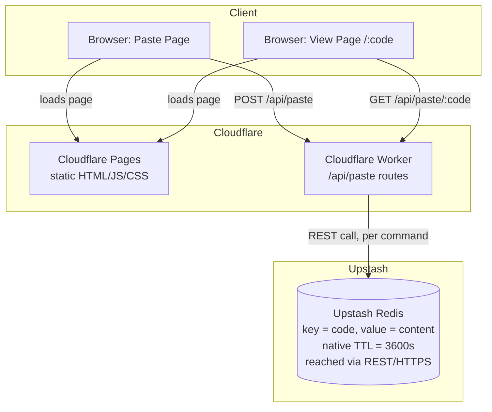
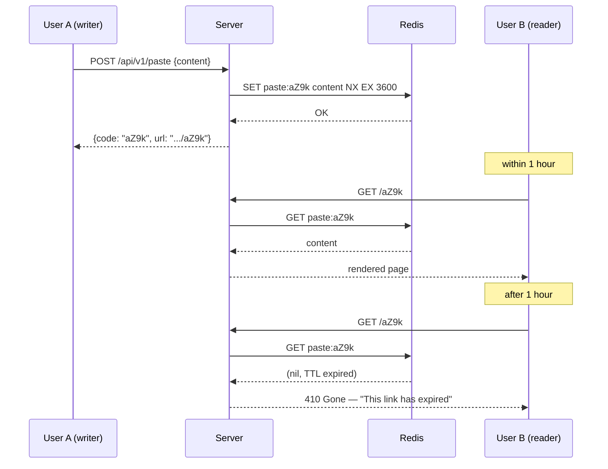

# System Design: Short-Link Text Sharing Platform

A pastebin-style service — paste text, get a 4-character short link, link expires after 1 hour.

---

## 1. Requirements

### Functional
- User pastes text on a webpage and gets a short URL back.
- The URL is 4 characters, alphanumeric (`[A-Za-z0-9]`).
- Opening the URL shows the pasted content.
- The link (and its content) becomes invalid exactly 1 hour after creation.
- No login/auth needed for MVP — anyone can paste, anyone with the link can read.
- API-first, so a future desktop app can reuse the same backend.

### Non-functional
- Low latency: both paste-creation and paste-retrieval should be fast (<100 ms server-side).
- High availability: this is a "share a link in a meeting/chat" tool — it should basically never be down.
- Abuse resistance: rate limiting, size limits, output sanitization (this is a classic XSS/malware-drop vector).
- Horizontally scalable, stateless app tier.
- Self-cleaning storage (expired data shouldn't need manual deletion).

### Explicitly out of scope for now
- User accounts, custom aliases, edit history, analytics dashboards, desktop app (mentioned as future work in §8).

---

## 2. Capacity Estimation

This is the step that actually shapes the design, because **the 1-hour TTL caps how much live data ever exists at once** — this is not a "store forever" system like a real pastebin.

**Assumptions** (adjust to your real traffic):
- Peak write rate: **W = 50 pastes/sec**
- Read:write ratio ~10:1 → peak reads: **R = 500 reads/sec**
- Average paste size: 10 KB (enforce a max, e.g. 256 KB, to bound abuse)

**Live storage at any instant** (since anything older than 1 hour is gone):
```
active_pastes  = W × 3600s           = 50 × 3600      = 180,000 pastes
active_storage = active_pastes × 10KB = 180,000 × 10KB ≈ 1.8 GB
```
That comfortably fits in memory on a single mid-size Redis node — this is a small-data problem even at meaningful traffic, which is why an **in-memory store with native TTL is the right primary datastore**, not a traditional RDBMS.

**Short-code space:**
```
62 chars (a-z, A-Z, 0-9), 4 positions → 62^4 = 14,776,336 possible codes
```
At W = 50/sec, you generate 180,000 *concurrently live* codes per hour — about **1.2% of the keyspace in use at any moment**. Collision probability per new random code ≈ `active_pastes / 62^4` ≈ 1.2%, trivially handled by a generate-and-retry loop (§4). If you expect much higher sustained throughput, see the scaling note in §7.

### 2.1 What the free tiers actually let you do (checked live, Aug 2026)

The W=50/sec scenario above is a "what if this got popular" ceiling. On **Cloudflare Workers (free) + Upstash Redis (free)** the real ceiling is much lower, and it's the Redis *command* budget that binds first, not requests or CPU:

| Resource | Free allowance | Consumed by |
|---|---|---|
| Cloudflare Workers requests | 100,000/day | 1 request per paste-create, 1 per paste-view |
| Upstash Redis commands | 500,000/**month** (~16,600/day), 256 MB data | 1 `SET` per create, 1 `GET` per view (plus retries on rare collisions) |

Workers requests are not the bottleneck (100K/day is generous). **Redis commands are.** Working backward from ~16,600 commands/day with a 10:1 read:write ratio (11 commands per "unit" of traffic):

```
16,600 / 11 ≈ 1,500 creates/day  and  ~15,000 views/day
```

That's roughly **one new paste per minute, sustained, all day** — plenty for a personal tool, an internal team utility, or a small public launch, but worth knowing before you assume you're covered at real scale. If you outgrow it: Upstash pay-as-you-go is $0.20 per 100K commands (cheap — a few dollars covers a lot of headroom) before you'd need to move off free entirely. See §10 for exactly what breaks first and what to do about it.

*(Cloudflare Workers **KV** is a tempting alternative to Redis since it's also native to the platform — but its free tier caps at **1,000 writes/day**, which you'd blow through in under an hour at this traffic. Upstash Redis's 500K/month command budget is a much better fit for a write-heavy paste service. Skip KV for this use case.)*

---

## 3. High-Level Architecture

This maps onto an all-serverless, all-free-tier stack: **Cloudflare Pages** for the static frontend, a **Cloudflare Worker** (or Pages Function — same billing, same runtime) for the API, and **Upstash Redis** as the datastore, reached over Upstash's **REST API** rather than a raw TCP connection.



**Why this combo, and one important wiring detail:**
- A Cloudflare Worker runs in the V8-isolate runtime, which historically has **no raw TCP socket access** — so a normal Redis client (which speaks the RESP protocol over TCP) won't work from inside it. Upstash's killer feature for this exact scenario is that it also exposes Redis **over a plain HTTPS REST API**, via the `@upstash/redis` npm package — every `SET`/`GET` becomes one `fetch()` call the Worker can make natively. This is *the* standard pattern for "Redis from the edge," not a workaround.
- Native `EXPIRE`/`SETEX` still gives you the 1-hour TTL and auto-deletion for free — no cron, no sweep job.
- Atomic `SET key value NX EX 3600` (§4) still gives you collision-safe code generation in one round trip — it's just an HTTPS call instead of a TCP one now.
- Both Cloudflare Pages and the Worker deploy from the same repo via the `wrangler` CLI; no servers, no containers, no load balancer to configure — Cloudflare's edge network *is* the load balancer.

If you later need durability beyond Redis, or analytics on paste volume, Cloudflare **D1** (free tier: 5 GB storage, 5M reads + 5M writes/month) is a natural same-ecosystem place to log **metadata only** (code, size, created_at) — never re-derive the TTL/expiry logic there, keep that in Redis.

---

## 4. Short Code Generation

```javascript
// inside the Cloudflare Worker, using @upstash/redis
import { Redis } from "@upstash/redis/cloudflare";

const redis = Redis.fromEnv(env); // reads UPSTASH_REDIS_REST_URL / TOKEN from env bindings

async function generateCode(content) {
  for (let attempt = 0; attempt < 5; attempt++) {
    const code = randomAlphanumeric(4); // [A-Za-z0-9]
    const ok = await redis.set(`paste:${code}`, content, { nx: true, ex: 3600 });
    if (ok) return code;
  }
  throw new Error("keyspace pressure — widen code length or shorten TTL");
}
```

- `nx: true` (only set if not exists) + `ex: 3600` (expire in 3600s) is a **single atomic Redis command over one REST call** — no race condition between "check if taken" and "claim it," and importantly, **no wasted command budget** on a separate existence check.
- 5 retries is generous given the ~1.2% collision rate estimated in §2; each retry is one more billed Upstash command, so don't raise this without reason.
- Avoid ambiguous characters (`0/O`, `1/l/I`) if people will ever read codes aloud or retype them — optional, trades a little keyspace for usability.

---

## 5. API Design

Versioned from day one (`/api/v1/...`) since the desktop app will consume the same surface later. All three routes are handled by **one Worker script** using its built-in router (or Hono, which is the common lightweight choice for Workers).

| Method | Endpoint | Purpose |
|---|---|---|
| `POST` | `/api/v1/paste` | Create a paste. Body: `{ "content": "..." }`. Returns `{ "code": "aZ9k", "url": "https://short.ly/aZ9k", "expiresAt": "2026-08-14T13:00:00Z" }` |
| `GET` | `/api/v1/paste/:code` | Fetch raw content + metadata as JSON. `404` if never existed, `410 Gone` if expired. |
| `GET` | `/:code` | Serves the front-end **view page**, which then calls the JSON endpoint above to render content. |

`wrangler.toml` routes `/api/*` to the Worker and lets Cloudflare Pages serve everything else (including `/:code`, which is just a static HTML shell that fetches its own data client-side) — no separate backend deployment, no CORS headache since it's the same domain.



---

## 6. Frontend (Website Only, for Now)

Two simple pages, static-hosted on **Cloudflare Pages** (free, unlimited bandwidth, deployed straight from your git repo) and talking to the Worker API:

- **Home page (`/`)**: textarea + "Create Link" button → calls `POST /api/v1/paste` → shows the resulting short URL with a copy button and a live "expires in 59:58" countdown.
- **View page (`/:code`)**: on load, calls `GET /api/v1/paste/:code`. If `200`, render content as **plain text** (never `innerHTML` raw user input — see §7 security). If `410`/`404`, show a clear "This paste has expired or doesn't exist" state.

---

## 7. Security & Abuse Considerations

- **XSS**: always render pasted content as escaped text (`textContent`, not `innerHTML`). Never interpret paste content as HTML/JS.
- **Size limits**: cap paste size (e.g. 256 KB) at the API layer to prevent storage/bandwidth abuse.
- **Rate limiting**: per-IP token bucket to stop spam/scripted abuse — a 4-char link generator is an attractive target for throwaway malware/phishing hosting, so this matters more than it sounds. `@upstash/ratelimit` is the drop-in choice (it's built for exactly this Worker+Upstash pairing) but note **each check itself costs Redis commands**, eating into the same 500K/month budget as your actual pastes. On a free-tier build, either (a) accept the extra cost — a sliding-window check is usually 1–2 commands per request, which is a small tax — or (b) do a cheaper first-pass check using the Worker's own in-memory/CPU-based limiting for obvious bursts, and reserve the Redis-backed limiter for edge cases.
- **Abuse content**: consider basic automated scanning (known-malware-hash check, URL blocklist scanning) since anyone can host arbitrary text/links anonymously.
- **HTTPS only**, HSTS on the frontend domain.

---

## 8. Scaling & Future Work

- **If you outgrow the free tier** (see §10), the upgrade path is incremental, not a rewrite: Upstash pay-as-you-go is $0.20/100K commands with no code changes, and Cloudflare's Workers Paid plan is $5/month flat. You'd likely spend single-digit dollars/month before needing anything more than that.
- **If write throughput grows** past what makes sense for one Redis keyspace, either (a) lengthen the code to 5–6 chars (62^5 ≈ 916M), or (b) move to an Upstash Global database (read replicas near users) — both are cheap changes since the Worker is stateless.
- **Desktop app**: because the design is already API-first (§5) with versioned JSON endpoints, the desktop app is just another client hitting `/api/v1/paste` — no backend changes needed. At that point, consider adding an API key or lightweight auth if you want to distinguish/rate-limit desktop traffic separately from the website.
- **Optional durability**: Upstash Redis already persists to disk by default (unlike vanilla self-hosted Redis, which is in-memory only) — so you don't lose data on a restart the way you would with DIY Redis. If you want audit history beyond the TTL window, log metadata (not content) to Cloudflare D1.

---

## 9. Suggested Stack (free-tier-first)

| Layer | Choice | Free tier |
|---|---|---|
| Frontend | Cloudflare Pages (static HTML/JS/CSS) | Unlimited requests/bandwidth |
| API | Cloudflare Worker (or Pages Function) | 100,000 requests/day |
| Datastore | Upstash Redis, via REST (`@upstash/redis`) | 500,000 commands/month, 256 MB data |
| Rate limiting | `@upstash/ratelimit` or Worker-side in-memory check | Shares the Redis command budget |
| Deployment | `wrangler` CLI, from a git repo | Free |
| Domain | Your own domain (for a clean short link) or a `workers.dev`/`pages.dev` subdomain | `*.workers.dev` free; custom domain is a separate registrar cost |

---

## 10. Free-Tier Budget: What Breaks First, and How to Watch It

At the traffic level estimated in §2.1, here's the order things would actually hit a wall, so you know what to monitor:

1. **Upstash Redis commands (500K/month)** — this is the binding constraint, not Workers requests. Watch it in the Upstash console dashboard, which shows daily command usage against the monthly cap.
2. **Upstash storage (256 MB)** — only a concern if you allow very large pastes or don't enforce a size cap; at 10 KB average pastes this isn't close to the limit (§2).
3. **Cloudflare Workers requests (100K/day)** — very unlikely to bind first given the Redis ceiling is much lower in request-equivalent terms.

Practical takeaway: **enforce a paste size cap and keep rate limiting on from day one** (§7) — on a free-tier deployment, abuse doesn't just degrade UX, it burns through your entire month's Redis budget for everyone.
